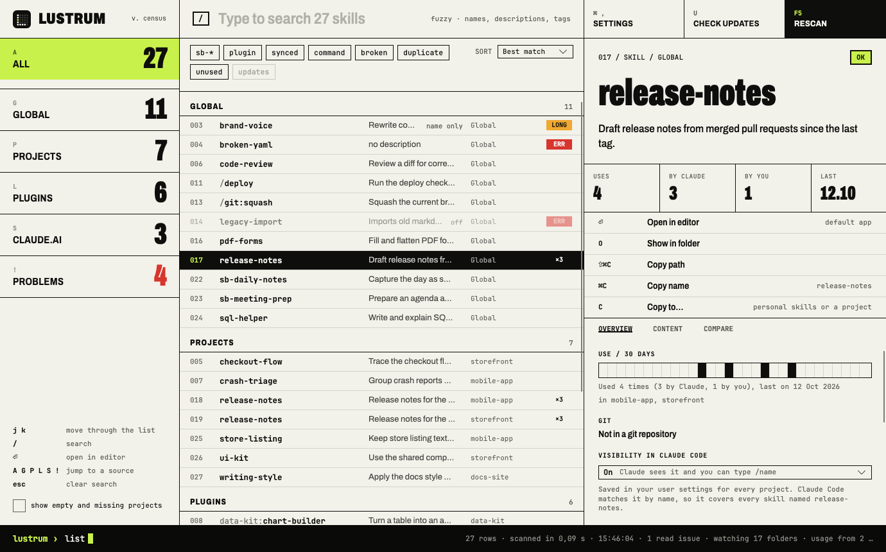
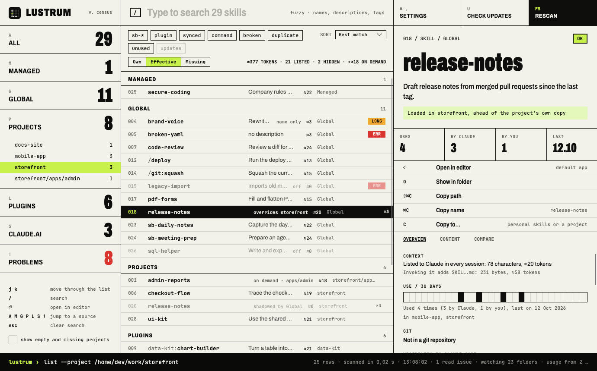
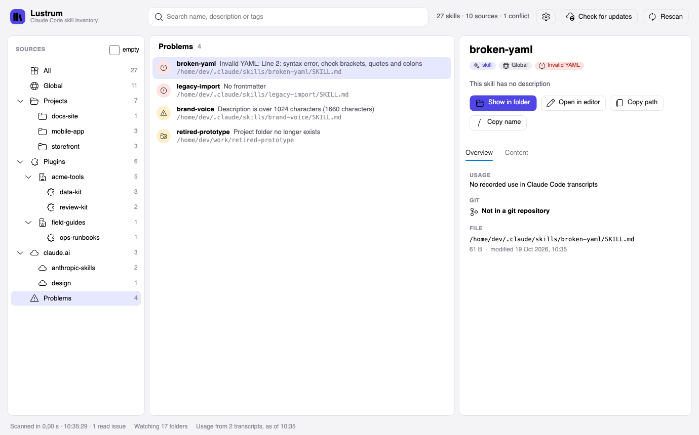
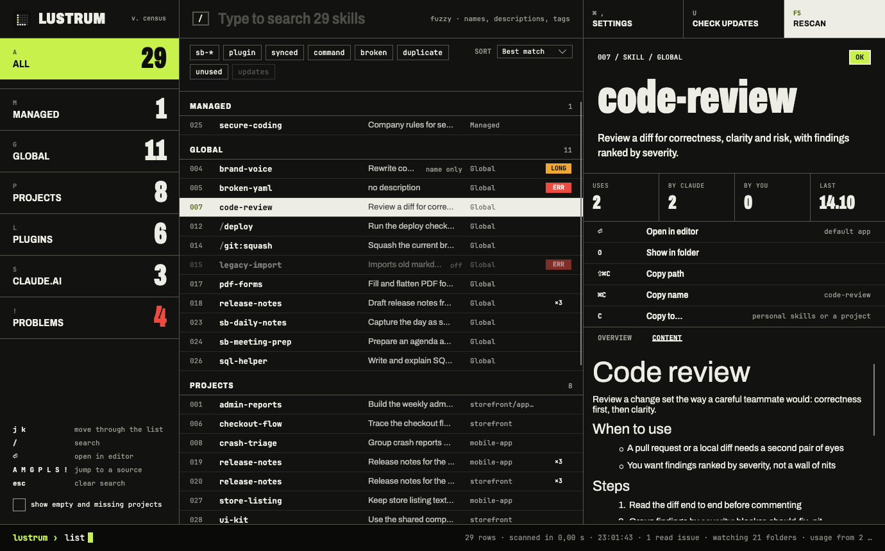
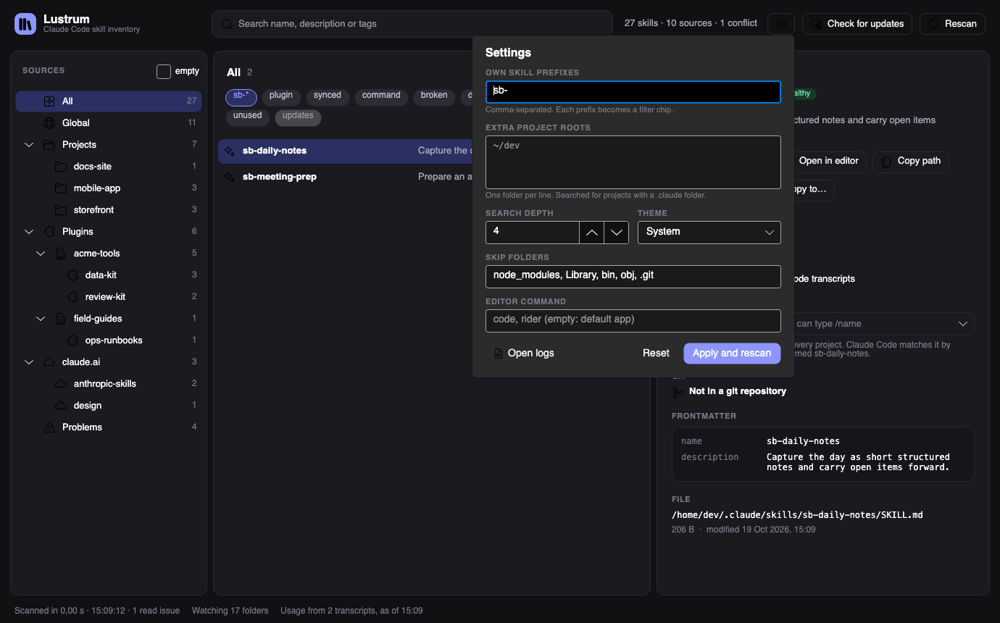
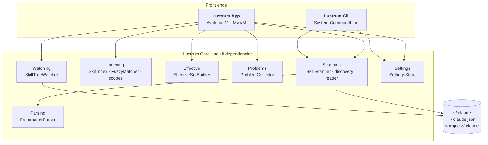

<div align="center">


# Lustrum

**A census of every Claude Code skill on your machine.**

Global skills, per-project skills, plugin skills and slash commands, in one window.<br/>
Read-only towards Claude Code: nothing is written to `~/.claude`.

[](https://github.com/sburdenko/lustrum/actions/workflows/ci.yml)




</div>

## Why

Claude Code spreads skills over several places. `/plugin` shows plugins, `/skills` shows the current project,
and `npx skills list` shows the current folder plus home. Nothing answers the questions that come up once you
have a few dozen skills:

- What skills do I have, and where does each one live?
- Which ones does project X actually load?
- Where do names collide, and which copy wins?
- Which ones are broken (no frontmatter, bad YAML, missing description)?

Lustrum scans the disk, builds an immutable snapshot and shows it in a desktop window or prints it from a CLI.
The window keeps itself up to date while you edit skills.

## Get it

**Prebuilt.** Every `v*` tag publishes self-contained archives to
[Releases](https://github.com/sburdenko/lustrum/releases) for `win-x64`, `osx-arm64`, `osx-x64` and `linux-x64`.
No .NET install is needed. Each archive holds the app (`lustrum/Lustrum`) and the CLI (`lustrum/cli/lustrum`).
The binaries are not signed, so macOS Gatekeeper blocks them until you clear the quarantine flag:

```bash
xattr -dr com.apple.quarantine lustrum
```

**From source.** You need the [.NET 10 SDK](https://dotnet.microsoft.com/download).

```bash
git clone https://github.com/sburdenko/lustrum.git
cd lustrum

dotnet run --project src/Lustrum.App                   # the window
dotnet run --project src/Lustrum.Cli -- list           # the same data in the terminal
dotnet test                                            # 168 tests
```

The window is developed on macOS. CI builds and tests on Ubuntu, macOS and Windows.

## What you get

| | |
|---|---|
| **Source tree** | All, Global, Projects, Plugins (marketplace, then plugin), Problems. Every node has a count; disabled plugins and empty projects are dimmed. |
| **Effective set** | Pick a project and tick **Effective set**: the list shows exactly what that project loads, marks skills that are shadowed and says what overrides what. |
| **Skill list** | Name with plugin prefix, description, source, health marker. Sort by best match, name, source or date. |
| **Search** | Fuzzy on names, substring on descriptions and tags, ranked by relevance. Optionally searches the text of every `SKILL.md`. |
| **Filter chips** | One chip per own prefix (`sb-*` by default), plus `plugin`, `command`, `broken`, `duplicate`. Chips combine. |
| **Problems** | One list of broken skills (with the YAML line and cause), over-long descriptions, projects whose folder is gone and paths that could not be read. |
| **Skill card** | Description, health, parsed frontmatter, file path, sibling files, name conflicts, rendered `SKILL.md`. |
| **Actions** | Show in file manager, open in editor, copy path, copy invocation name (`/deploy`, `unity:ui`). |
| **Live updates** | File system watchers trigger a rescan half a second after skills or plugin settings change. |
| **Settings** | Own prefixes, extra project roots, search depth, skipped folders, editor command (quote paths with spaces), theme. |
| **Keys** | `Ctrl/Cmd+F` search · `F5` rescan · `Esc` clear search · `Ctrl/Cmd+1/2/3` focus a column · `Ctrl/Cmd+Shift+C` copy path · `Ctrl/Cmd+C` in the list copies the name |

<table>
<tr>
<td width="50%"></td>
<td width="50%"></td>
</tr>
<tr>
<td align="center"><sub>Effective set: the project copy overrides the global one</sub></td>
<td align="center"><sub>Problems</sub></td>
</tr>
<tr>
<td width="50%"></td>
<td width="50%"></td>
</tr>
<tr>
<td align="center"><sub>Rendered <code>SKILL.md</code>, dark theme</sub></td>
<td align="center"><sub>Settings and filter chips</sub></td>
</tr>
</table>

The screenshots use a synthetic `~/.claude` tree, not a real machine.

## Where it looks

| Source | Location | Skill name |
|---|---|---|
| Global skills | `~/.claude/skills/<folder>/SKILL.md` | `name` from frontmatter, else the folder name |
| Global commands | `~/.claude/commands/**/*.md` (up to 3 levels) | file path without `.md`, folders joined with `:` (`git/squash.md` is `/git:squash`) |
| Project skills and commands | `<project>/.claude/skills`, `<project>/.claude/commands` | same rules as global |
| Plugins | the `installPath` of every entry in `~/.claude/plugins/installed_plugins.json` | `<plugin>:<name>` |

**Which projects.** Lustrum merges three lists by normalised path:

1. the keys of `projects` in `~/.claude.json`;
2. the folder names in `~/.claude/projects`;
3. folders with a `.claude` directory under the extra roots from Settings (searched to the configured depth,
   default 4, skipping `node_modules`, `Library`, `bin`, `obj`, `.git`).

Your home directory is skipped, because its `.claude` is already the global source. A project whose folder no
longer exists stays in the data with `Exists = false`; the tree hides it until you tick **empty**, and the
Problems list shows it.

**Which plugins.** The registry file is authoritative. Without it, Lustrum falls back to
`~/.claude/plugins/cache/<marketplace>/<plugin>/<version>` and ignores versions that carry an `.orphaned_at` marker.
A plugin set to `false` under `enabledPlugins` in `~/.claude/settings.json` is shown as disabled and left out of
every effective set.

**Project folder names.** `~/.claude/projects` stores each path with every non-alphanumeric character replaced
by `-`. That mapping is lossy (`my-app`, `my_app` and `my/app` encode the same), so `ProjectPathDecoder`
resolves a name against the real file system: at each level it only follows directories whose own encoded
name is a prefix of the remaining string, preferring the longest match. Exact paths from `~/.claude.json` win
over decoding. Names that cannot be resolved are shown as missing, not guessed.

More on-disk details are in [docs/claude-code-layout.md](docs/claude-code-layout.md).

## Architecture

Three projects, one rule: **front ends never scan the file system themselves; everything goes through Core.**



### Scan pipeline


- Sources are scanned with `Parallel.ForEachAsync`, one source per task.
- Only the head of each file is read during a scan. `Skill.Body` stays `null`; the card loads it on demand
  through `SkillBodyReader` (capped at 1 MB).
- A file or folder that cannot be read becomes a `ScanIssue`. It never aborts the scan.

### Data model

Everything in `Lustrum.Core.Models` is an immutable `record`.

```csharp
SkillSource(Id, Kind, DisplayName, RootPath, LastSeen, Exists, IsEnabled)
Skill(Id, Name, FullName, Description, Kind, Source, Path, Body, Frontmatter,
      AllowedTools, Files, SizeBytes, Modified, Health, Tags)
Conflict(Name, Skills)
ScanResult(Sources, Skills, Conflicts, Issues, ScannedAt, Duration)
```

- `SourceKind`: `Global`, `Project`, `Plugin`. `SkillKind`: `Skill`, `Command`.
- `Skill.Id` is `<source id>#<path relative to the source root>`. It is unique inside a scan and survives
  a frontmatter rename.
- `FullName` carries the plugin prefix (`unity:ui`). Plugin skills are always prefixed, so they never
  produce a conflict.
- `Skill.Tags` are computed: own-prefix tags, `plugin`, `command`, `broken`, `duplicate`.

### Health

| Health | When | Counts as a problem |
|---|---|---|
| `Ok` | name and description present and valid | no |
| `DescriptionTooLong` | description longer than 1024 characters | yes, as a warning |
| `MissingDescription` | frontmatter has no `description` | yes |
| `MissingName` | frontmatter has no `name` (the folder name is used) | yes |
| `NoFrontmatter` | file does not start with `---` (folder name and first body line are used) | yes |
| `ParseError` | unclosed fence, invalid YAML or unreadable file | yes |

Commands are checked more leniently, because Claude Code does not require frontmatter for them: only
`ParseError` and `DescriptionTooLong` apply, and the name is always the file path.

The frontmatter parser strips a BOM, accepts CRLF, converts leading tabs to spaces, and takes
`allowed-tools` as either a YAML list or a comma-separated string (commas inside parentheses are kept,
so `Bash(git:*, status)` stays one entry). YAML errors are reported as `Line <n>: <cause>`, counted from the
top of the file.

### Effective set

`EffectiveSetBuilder.Build(scan, project)` takes that project's skills, the global skills and the skills of
enabled plugins. Within one name, a project skill wins over a global one: the winner is `Active` and lists what
it overrides, the loser is `Shadowed` and points at the winner. Plugin skills are always prefixed, so they are
never shadowed. Skills from other projects are not part of the set.

### Search and scopes

`SkillScope` is a small polymorphic hierarchy rather than a set of flags. Each scope decides for itself
which skills it includes.

| Scope | Includes |
|---|---|
| `AllScope` | everything |
| `KindScope(kind)` | all skills from global, project or plugin sources |
| `SourceScope(id)` | one project or one plugin |
| `MarketplaceScope(name)` | every plugin from one marketplace |
| `EffectiveScope(projectId)` | that project, global skills and enabled plugins |
| `ProblemsScope` | anything with a health problem, including `DescriptionTooLong` |

`SkillIndex.Search(skills, new SkillQuery(scope, text, requiredTags))` applies the scope and the tags, then the
text. Every word must match. Names are scored by `FuzzyMatcher`: exact, then prefix, then word start, then
substring, then an ordered subsequence (at least three characters, within three times the pattern length, so
`rlsnotes` finds `release-notes`). Descriptions and tags match as substrings only. With text, results are ordered
by score.

**Search SKILL.md text** runs `SkillBodySearch` 250 ms after you stop typing: it reads each `SKILL.md` body from
disk, keeps the ones that contain every word and appends them to the results. Bodies are not kept in memory.

### Live updates

`WatchTargets` picks what to watch. Skill and command folders and the plugin cache are watched recursively.
`~/.claude/plugins`, `~/.claude/projects` and each project's `.claude` are watched without subfolders, and
`~/.claude` itself only for `settings.json`, `skills` and `commands`, because Claude Code writes transcripts,
history and worktrees there constantly. `~/.claude.json` is not watched for the same reason; a new project still shows
up, because Claude Code creates its folder in `~/.claude/projects`.

`SkillTreeWatcher` debounces events by 500 ms. It falls back to polling a fingerprint every 30 s when there are
more folders than the platform handles comfortably (64 on Linux, where each watcher is an inotify instance, 256
elsewhere) or when native watchers cannot be created. It is built off the UI thread, and the status bar says which
mode is active.

### Threading

- The scan runs on the thread pool; `MainViewModel` applies the result on the UI thread.
- Starting a new rescan cancels the previous one, and a result from a superseded scan is dropped.
- Failures from the scan, the content search, the editor or the file manager are reported in the status bar.

### The window

`MainViewModel` is split into partial files by concern: list and sorting, content search, effective set,
problems, card, commands, settings. The view is split the same way into `SourcesPane`, `SkillListPane`,
`SkillCardPane` and `SettingsPanel`.

| Piece | Role |
|---|---|
| `NavTreeBuilder` | `ScanResult` to the source tree, with counts |
| `SkillItemViewModel` | one list row, including its effective-set label |
| `SkillCardViewModel` | the card; loads the `SKILL.md` body in the background |
| `ProblemItemViewModel` | one row in the Problems list |
| `SettingsEditorViewModel` | the editable copy of the settings |
| `IShellService`, `IClipboardService`, `ISettingsService`, `IThemeService` | the only places that touch the OS; faked in tests |

## Settings and logs

Settings live in `lustrum/settings.json` under the user's application-data folder:
`~/Library/Application Support` on macOS, `~/.config` on Linux, `%APPDATA%` on Windows. The file is written only
when you press **Apply and rescan**. Missing fields fall back to defaults; an unreadable file is reported and the
defaults are used. The CLI reads the same file.

Logs go to `lustrum/logs/lustrum-<date>.log` next to the settings, kept for 7 days. Each scan logs its size and
duration, every missing source and every read issue; the first scan also logs how long the window took to show
data. **Open logs** in the settings panel opens the folder.

## CLI

```text
lustrum list [--json] [--source global|project|plugin] [--broken] [--project <folder>]
```

```text
$ lustrum list --source plugin
NAME                            SOURCE                       HEALTH              DESCRIPTION
data-kit:chart-builder          data-kit (acme-tools)        ok                  Turn a table into an accessible chart with sensible defaults.
data-kit:csv-clean              data-kit (acme-tools)        ok                  Normalise encodings, delimiters and column names in messy CSV files.
/data-kit:export                data-kit (acme-tools)        ok                  Export the current dataset to CSV or Parquet.
ops-runbooks:incident-response  ops-runbooks (field-guides)  ok                  Walk through an incident: triage, comms, mitigation, follow-up.
review-kit:perf-audit           review-kit (acme-tools)      ok                  Find hot paths and allocation-heavy code in a profile or diff.
review-kit:security-scan        review-kit (acme-tools)      ok                  Scan changed files for injection, secrets and unsafe deserialization.

$ lustrum list --broken
NAME           SOURCE  HEALTH              DESCRIPTION
brand-voice    Global  DescriptionTooLong  Rewrite copy in the house tone of voice. Applies the style guide, banne…
broken-yaml    Global  ParseError          (no description)
legacy-import  Global  NoFrontmatter       Imports old markdown notes.
```

`--project` prints the effective set for one project folder, with an extra column saying what wins. The folder
needs a `.claude` directory; Claude Code does not have to know about it yet.

```text
$ lustrum list --project ~/work/storefront --source project
NAME           SOURCE      HEALTH              IN PROJECT        DESCRIPTION
checkout-flow  storefront  ok                  loaded            Trace the checkout flow and find where an order can get stuck.
release-notes  storefront  ok                  overrides Global  Release notes for the storefront: customer-facing wording, no ticket id…
ui-kit         storefront  ok                  loaded            Use the shared component library correctly: tokens, spacing, accessibil…
```

`--json` prints the full `Skill` records, including `frontmatter`, `allowedTools`, `files`, `health` and `tags`.
With `--project`, each record also carries `availability`, `shadowedBy` and `overrides` (skill ids).
Files that could not be read are reported on stderr as `warning: <path>: <reason>`.
An unknown `--source` or a folder without `.claude` exits with code 2.

## Repository layout

```text
lustrum/
├── src/
│   ├── Lustrum.Core/      Models/ Parsing/ Scanning/ Indexing/ Effective/ Problems/ Settings/ Watching/
│   ├── Lustrum.App/       Views/ ViewModels/ Services/ Assets/
│   └── Lustrum.Cli/       list command, table renderer
├── tests/
│   ├── Lustrum.Core.Tests/   scanner, discovery, parser, decoder, search, effective set, problems, settings, watcher
│   ├── Lustrum.App.Tests/    view models, source tree, services
│   └── Lustrum.Cli.Tests/    table output
├── docs/                  screenshots, Claude Code on-disk notes
├── .github/workflows/     CI on three OSes, release archives on tags
├── Directory.Build.props  net10.0, nullable, warnings as errors
└── lustrum.sln
```

## Tests

168 xUnit tests with FluentAssertions. Core tests do not scan your real `~/.claude`: `FakeClaudeHome` builds a
throw-away home directory with skills, commands, plugin registry, settings, project folders and `~/.claude.json`,
and the scanner runs against it. That makes the awkward cases cheap to cover: colliding project keys, malformed
registry files, unreadable folders, folders with dashes and dots in their names, frontmatter with a BOM and tabs,
oversized frontmatter, native and polling file watching. The App tests drive `MainViewModel` with a fake scan
function, shell, clipboard, settings and theme, including overlapping rescans and the effective set.

Measured with coverlet: 93% of lines in `Lustrum.Core`, 81% in the view models.

```bash
dotnet test
```

## Built with

[Avalonia 11](https://avaloniaui.net/) · [CommunityToolkit.Mvvm](https://github.com/CommunityToolkit/dotnet) ·
[YamlDotNet](https://github.com/aaubry/YamlDotNet) · [FluentIcons.Avalonia](https://github.com/davidxuang/FluentIcons) ·
[Markdown.Avalonia](https://github.com/whistyun/Markdown.Avalonia) · [System.CommandLine](https://github.com/dotnet/command-line-api) ·
[Serilog](https://serilog.net/) · xUnit

## Limitations

- Only files on disk are visible. Skills managed in claude.ai settings and skills bundled with Claude are not listed.
- The effective set follows two rules: project over global for the same name, and plugins only when enabled in the
  user-level `~/.claude/settings.json`. Project-level settings files are not read.
- The window has only been run on macOS; on Windows and Linux only the tests run in CI.
- Release binaries are unsigned and are plain executables, not an `.app`, installer or AppImage.

## Name

A *lustrum* was the Roman census, taken every five years: count everyone, then purify the books.
