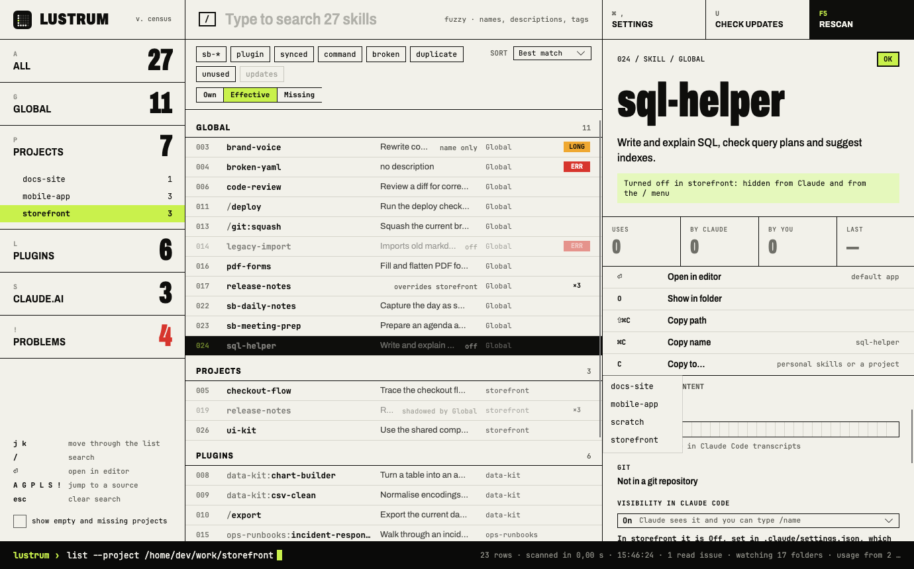
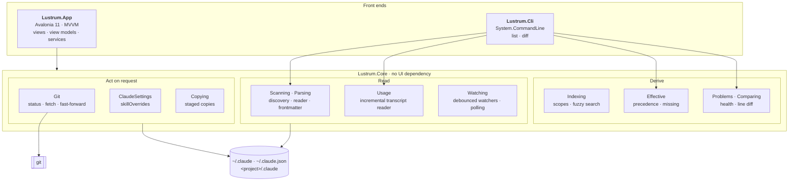
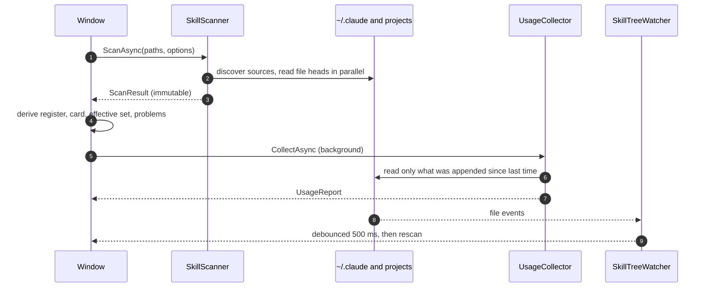

<div align="center">


# Lustrum

**A census of every Claude Code skill on your machine.**

Global, project, plugin and claude.ai-synced skills and slash commands in one keyboard-first window,<br/>
with the same data in a CLI. Nothing changes on its own: Lustrum writes only when you ask it to.

[](https://github.com/sburdenko/lustrum/actions/workflows/ci.yml)


<picture>
  <source media="(prefers-color-scheme: dark)" srcset="docs/overview-dark.png">
  
</picture>

</div>

## Why

Claude Code spreads skills over several places. `/plugin` shows plugins, `/skills` shows the current project, and
`npx skills list` shows the current folder plus home. Nothing answers the questions that come up once you have a few
dozen skills:

- What skills do I have, and where does each one live?
- Which ones does project X actually load, and which copy wins when names collide?
- Which ones are broken, and which are never used?
- Which ones came from git, and has the upstream moved on since?

Lustrum scans the disk into an immutable snapshot, derives every view from it, and keeps itself up to date while you
edit skills.

## What it does

| | |
|---|---|
| **Inventory** | Every skill and command from personal, project, plugin and claude.ai sources, with counts per source and per marketplace. Fuzzy search on names, substring on descriptions and tags, optionally the text of every `SKILL.md`. |
| **Project views** | Pick a project and switch between **Own** (its skills), **Effective** (exactly what Claude Code loads there, following its precedence rules) and **Missing** (skills on this machine it does not load). |
| **Register** | A numbered list grouped by kind, with the state of each skill (shadowed, off, behind) and a mark for errors, long descriptions and duplicate names. Filter chips combine: own prefixes, `plugin`, `synced`, `command`, `broken`, `duplicate`, `unused`, `updates`. |
| **Health** | One Problems list: broken frontmatter with the YAML line and cause, over-long descriptions, projects whose folder is gone, paths that could not be read. |
| **Usage** | How often each skill was used, by Claude or by you, when last and in which projects, with a 30-day strip, read incrementally from Claude Code transcripts. |
| **Compare** | A line diff between copies of one name, with unchanged runs folded. |
| **Git** | Branch, upstream, behind and ahead, uncommitted changes and last commit for skills in a git repository. **Check for updates** fetches; **Update** fast-forwards a repository that holds only skills. |
| **Visibility** | Turn a skill on, name-only, user-only or off through Claude Code's own `skillOverrides` setting, the switch behind its `/skills` menu. |
| **Copy to** | Copy a skill into your personal skills or a project, for example to share it with a team or to customise a plugin skill. Nothing is overwritten. |
| **CLI line** | The bar at the bottom shows the `lustrum` command that prints the current view, such as `list --project ~/work/storefront --missing` or `diff release-notes`. |
| **Live** | File system watchers rescan half a second after a skill or a plugin setting changes. |

<table>
<tr>
<td width="50%"></td>
<td width="50%"></td>
</tr>
<tr>
<td align="center"><sub><b>Effective</b> · what a project loads; the personal copy wins</sub></td>
<td align="center"><sub><b>Missing</b> · what other projects have and this one does not</sub></td>
</tr>
<tr>
<td width="50%"></td>
<td width="50%"></td>
</tr>
<tr>
<td align="center"><sub><b>Problems</b> · every broken thing in one list</sub></td>
<td align="center"><sub><b>Compare</b> · two copies of one name, line by line</sub></td>
</tr>
<tr>
<td width="50%"></td>
<td width="50%"></td>
</tr>
<tr>
<td align="center"><sub><b>Git</b> · a cloned skill two commits behind</sub></td>
<td align="center"><sub><b>Visibility · Copy to</b> · project settings turn a skill off</sub></td>
</tr>
<tr>
<td width="50%"></td>
<td width="50%"></td>
</tr>
<tr>
<td align="center"><sub><b>Content</b> · rendered <code>SKILL.md</code>, dark theme</sub></td>
<td align="center"><sub><b>Settings</b> · prefixes, roots, editor, theme</sub></td>
</tr>
</table>

<sub>Screenshots come from a synthetic `~/.claude`, rendered headless by `tools/Lustrum.Screenshots`.</sub>

## Keyboard

| Key | Action | Key | Action |
|---|---|---|---|
| `j` `k` | move through the list | `/` | search |
| `⏎` | open in editor | `O` | show in folder |
| `C` | copy to… | `D` | compare copies |
| `U` | check all repositories for updates | `A` `G` `P` `L` `S` `!` | jump to All, Global, Projects, Plugins, claude.ai, Problems |
| `Esc` | clear search | `F5` | rescan |
| `Cmd/Ctrl+C` | copy the invocation name | `Cmd/Ctrl+Shift+C` | copy the path |
| `Cmd/Ctrl+,` | settings | `Cmd/Ctrl+1/2/3` | focus a column |

## Get it

**Prebuilt.** Every `v*` tag publishes self-contained builds to
[Releases](https://github.com/sburdenko/lustrum/releases); no .NET install is needed.

| Platform | Download | Contents |
|---|---|---|
| macOS (Apple silicon, Intel) | `lustrum-<tag>-osx-arm64.zip`, `lustrum-<tag>-osx-x64.zip` | `Lustrum.app` and `cli/lustrum` |
| Linux x64 | `Lustrum-<tag>-x86_64.AppImage`, `lustrum-<tag>-linux-x64.tar.gz` | AppImage of the app; archive with the app and the CLI |
| Windows x64 | `lustrum-<tag>-win-x64.zip` | `Lustrum.exe` and `cli\lustrum.exe` |

The macOS app is ad-hoc signed but not notarized, so Gatekeeper blocks it until you clear the quarantine flag:

```bash
xattr -dr com.apple.quarantine Lustrum.app
```

**From source.** You need the [.NET 10 SDK](https://dotnet.microsoft.com/download).

```bash
git clone https://github.com/sburdenko/lustrum.git && cd lustrum
dotnet run --project src/Lustrum.App               # the window
dotnet run --project src/Lustrum.Cli -- list       # the same data in a terminal
dotnet test                                        # 396 tests
```

## Architecture



**Principles**

- **One snapshot.** A scan produces an immutable `ScanResult`. Every list, count, effective set and problem is derived
  from it, and the window and the CLI share the same code.
- **Core owns the rules.** Discovery, Claude Code's precedence rules, health, usage, git and settings handling live in
  `Lustrum.Core`, which has no UI dependency. Front ends only present.
- **States are types, not flags.** Scopes, project views, usage, git state, update decisions and copy plans are small
  record hierarchies; each case carries exactly the data it needs and knows how to describe itself.
- **Read-only until asked.** Three writes exist, each behind an explicit control, each re-checking its preconditions
  on fresh state right before it writes.
- **Failures are data.** An unreadable file becomes a `ScanIssue` and shows up in Problems; nothing aborts a scan, and
  no error closes the window.
- **The OS sits behind interfaces.** Shell, clipboard, settings, theme, git and writes are services, faked in view
  model tests; Core tests run against throw-away homes and real git repositories.



**What Lustrum writes, and the guarantees**

| Action | Writes | Before writing it checks | How it writes |
|---|---|---|---|
| **Visibility** | one `skillOverrides` entry in `~/.claude/settings.json` (personal skill) or `<project>/.claude/settings.local.json` (project skill) | the file is plain JSON and an object; it has not changed since it was read | every other key and character kept; follows links; temporary file with the same mode, flushed, then moved over |
| **Copy to** | a new skill folder or command file in personal skills or a project | nothing with that folder name or skill name exists in the target; under 2,000 files and 50 MB | without `.git` and linked files; staged outside `skills/`, moved into place at the end |
| **Update** | the working tree of a git repository that holds only skills | fresh fetch; on a branch with an upstream; behind; clean tree; no local commits; no ignored file would be replaced | `git merge --ff-only @{u}`, never a merge commit |

Network access happens only on **Check for updates** and **Update**.

| Core module | Responsibility | Key types |
|---|---|---|
| `Scanning` · `Parsing` | find sources, read skills, parse frontmatter, decode project folder names | `SkillScanner`, `SourceDiscovery`, `FrontmatterParser`, `ProjectPathDecoder` |
| `Indexing` | scopes and ranked search | `SkillScope`, `SkillIndex`, `FuzzyMatcher` |
| `Effective` | what a project loads and what it misses, by Claude Code's rules | `EffectiveSetBuilder`, `MissingSetBuilder` |
| `Problems` · `Comparing` | health problems; folded line diffs | `ProblemCollector`, `SkillComparer` |
| `Usage` | incremental transcript reading | `UsageCollector`, `TranscriptParser`, `SkillUsage` |
| `Git` | repository roles, status, fetch, update policy | `GitRepositoryLocator`, `SkillGit`, `UpdatePolicy`, `GitCli` |
| `ClaudeSettings` | `skillOverrides` across settings files, safe edits | `SkillOverrides`, `ClaudeSettingsWriter` |
| `Copying` | planned, staged copies | `SkillCopier`, `CopyPlan` |
| `Watching` | what to watch, debouncing, polling fallback | `WatchTargets`, `SkillTreeWatcher` |

The full design notes, from discovery and the data model to the git and write paths, threading and the window, are in
**[docs/architecture.md](docs/architecture.md)**. The Claude Code files Lustrum reads are described in
[docs/claude-code-layout.md](docs/claude-code-layout.md).

## CLI

```text
lustrum list [--json] [--source global|project|plugin|synced] [--broken] [--project <folder> [--missing]] [--usage] [--unused]
lustrum diff <name>
```

```text
$ lustrum list --project ~/work/storefront --source project
NAME           SOURCE      HEALTH              IN PROJECT          DESCRIPTION
checkout-flow  storefront  ok                  loaded              Trace the checkout flow and find where an order can get stuck.
release-notes  storefront  ok                  shadowed by Global  Release notes for the storefront: customer-facing wording, no ticket id…
ui-kit         storefront  ok                  loaded              Use the shared component library correctly: tokens, spacing, accessibil…

$ lustrum list --broken
NAME           SOURCE  HEALTH              DESCRIPTION
brand-voice    Global  DescriptionTooLong  Rewrite copy in the house tone of voice. Applies the style guide, banne…
broken-yaml    Global  ParseError          (no description)
legacy-import  Global  NoFrontmatter       Imports old markdown notes.
```

- `--project <folder>` prints that project's effective set with an `IN PROJECT` column; `--missing` lists what it
  does not load, with a `NOTE` for disabled plugins and names loaded from elsewhere.
- `--usage` adds `USES` and `LAST USED`; `--unused` keeps skills with no recorded use and refuses to run when there are
  no transcripts at all.
- `--json` prints full records: frontmatter, allowed tools, files, health, tags, and with `--project` the
  availability, `shadowedBy`, `overrides` and `visibility`.
- `diff <name>` prints every copy of a name against the project copy in unified format.
- Unreadable files go to stderr as `warning: <path>: <reason>`. Exit code 2 means bad input (unknown source, a folder
  without `.claude`, an unknown name); exit code 1 means a copy could not be read.

## Quality

| | |
|---|---|
| **Tests** | 396 xUnit tests, about 4,700 lines, more than the Core code they cover |
| **Coverage** | 91% of lines in `Lustrum.Core`, 87% in the view models (coverlet) |
| **Real environments** | scanner tests on throw-away home folders; git tests on real repositories with a bare remote; writer tests on real files, links and file modes |
| **CI** | the full suite on Ubuntu, macOS and Windows for every pull request; `main` only accepts green changes |
| **Builds** | warnings are errors; self-contained single-file releases for macOS (arm64, x64), Linux x64 and Windows x64 |
| **Size** | Core about 3,300 lines of C#, the window about 3,000 lines of C# and 1,100 of XAML, the CLI about 350 |

```text
lustrum/
├── src/
│   ├── Lustrum.Core/        Scanning/ Parsing/ Indexing/ Effective/ Problems/ Comparing/ Usage/ Git/ ClaudeSettings/ Copying/ Watching/ Settings/ Models/
│   ├── Lustrum.App/         Views/ ViewModels/ Services/ Controls/ Assets/
│   └── Lustrum.Cli/         list and diff commands, table renderer
├── tests/                   Core, App and CLI test projects
├── tools/Lustrum.Screenshots/   headless renderer for the screenshots above
├── docs/                    architecture, Claude Code layout, screenshots
├── build/                   macOS app bundle and Linux AppImage packaging
└── .github/workflows/       CI on three OSes, release builds on tags
```

## Settings and logs

Settings live in `lustrum/settings.json` under the user's application-data folder (`~/Library/Application Support`
on macOS, `~/.config` on Linux, `%APPDATA%` on Windows) and are written only on **Apply and rescan**. Logs go to
`lustrum/logs/`, kept for 7 days: scan size and duration, missing sources, read issues and time to first data.

## Limitations

- Only files on disk are visible. claude.ai skills appear only where the Claude desktop app has synced them, and the
  synced layout is not documented by Anthropic; nor is the transcript format usage is read from.
- Enterprise (managed) skills and settings are not read. Plugins count as enabled or disabled by the user-level
  `~/.claude/settings.json` only.
- Skills in nested `.claude/skills` folders below a project root, or in parent folders up to the repository root, are
  not discovered; Claude Code loads those too.
- Claude Code's documentation does not say how `skillOverrides` from several files combine; Lustrum assumes key by key,
  the higher file winning.
- Git features need `git` on the `PATH`; a remote that asks for a password fails the check instead of prompting.
  **Update** only fast-forwards and runs the repository's own hooks, as `git merge` would.
- The window is developed on macOS; on Windows and Linux the test suite runs in CI. The macOS app is not notarized, and
  there is no Windows installer.

## Built with

[Avalonia](https://avaloniaui.net/) · [CommunityToolkit.Mvvm](https://github.com/CommunityToolkit/dotnet) ·
[YamlDotNet](https://github.com/aaubry/YamlDotNet) · [DiffPlex](https://github.com/mmanela/diffplex) ·
[Markdown.Avalonia](https://github.com/whistyun/Markdown.Avalonia) · [System.CommandLine](https://github.com/dotnet/command-line-api) ·
[Serilog](https://serilog.net/) · [FluentIcons](https://github.com/davidxuang/FluentIcons) · xUnit · FluentAssertions

Type: [Archivo](https://github.com/Omnibus-Type/Archivo) and [JetBrains Mono](https://github.com/JetBrains/JetBrainsMono),
both under the SIL Open Font License; the licence texts sit next to the font files.

## Name

A *lustrum* was the Roman census, taken every five years: count everyone, then purify the books.
