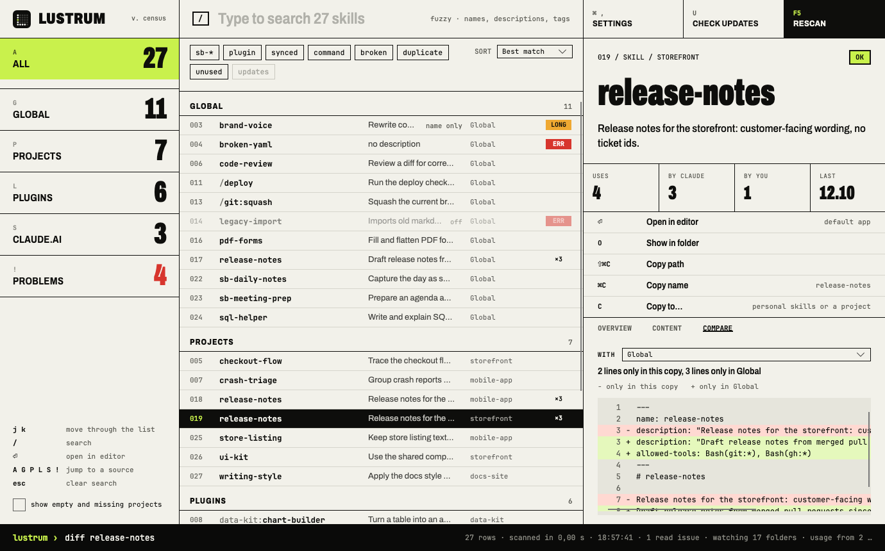
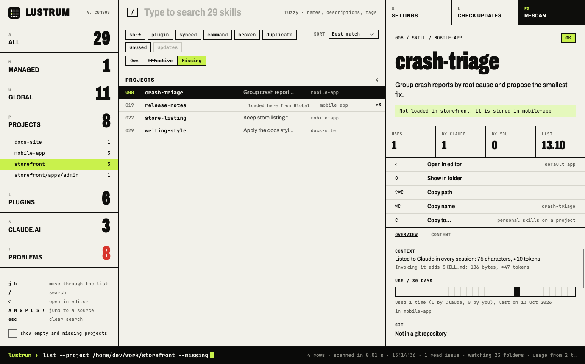
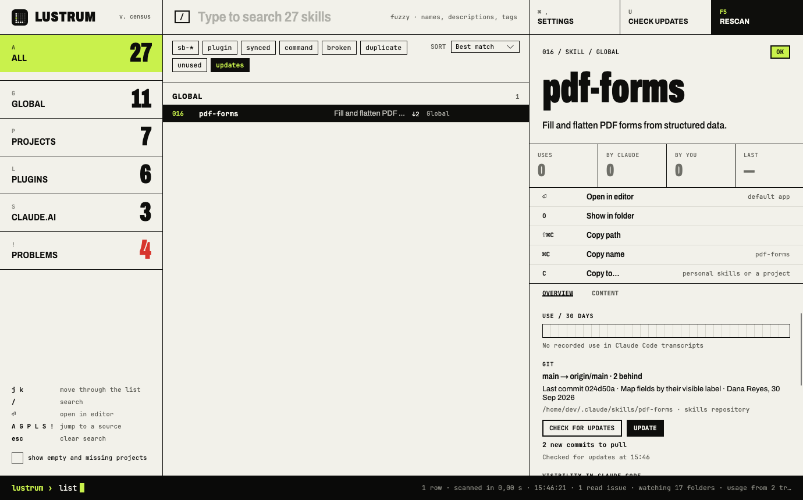
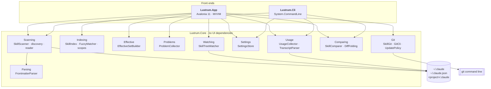

<div align="center">


# Lustrum

**A census of every Claude Code skill on your machine.**

Global, project, plugin and claude.ai-synced skills and slash commands, in one window.<br/>
Read-only towards Claude Code. The one write is the **Update** button: a fast-forward of a git repository that holds only skills.

[](https://github.com/sburdenko/lustrum/actions/workflows/ci.yml)


</div>

## Why

Claude Code spreads skills over several places. `/plugin` shows plugins, `/skills` shows the current project,
and `npx skills list` shows the current folder plus home. Nothing answers the questions that come up once you
have a few dozen skills:

- What skills do I have, and where does each one live?
- Which ones does project X actually load?
- Where do names collide, which copy wins, and how do the copies differ?
- Which ones are broken (no frontmatter, bad YAML, missing description)?
- Which ones are never used?
- Which ones came from git, and has the upstream moved on since?

Lustrum scans the disk, builds an immutable snapshot and shows it in a desktop window or prints it from a CLI.
The window keeps itself up to date while you edit skills.

## Get it

**Prebuilt.** Every `v*` tag publishes self-contained builds to
[Releases](https://github.com/sburdenko/lustrum/releases). No .NET install is needed.

| Platform | Download | Contents |
|---|---|---|
| macOS (Apple silicon, Intel) | `lustrum-<tag>-osx-arm64.zip`, `lustrum-<tag>-osx-x64.zip` | `Lustrum.app` and `cli/lustrum` |
| Linux x64 | `Lustrum-<tag>-x86_64.AppImage`, `lustrum-<tag>-linux-x64.tar.gz` | AppImage of the app; archive with the app and the CLI |
| Windows x64 | `lustrum-<tag>-win-x64.zip` | `Lustrum.exe` and `cli\lustrum.exe` |

The macOS app is ad-hoc signed but not notarized, so Gatekeeper blocks it until you clear the quarantine flag:

```bash
xattr -dr com.apple.quarantine Lustrum.app
```

**From source.** You need the [.NET 10 SDK](https://dotnet.microsoft.com/download).

```bash
git clone https://github.com/sburdenko/lustrum.git
cd lustrum

dotnet run --project src/Lustrum.App                   # the window
dotnet run --project src/Lustrum.Cli -- list           # the same data in the terminal
dotnet test                                            # 312 tests
```

The window is developed on macOS. CI builds and tests on Ubuntu, macOS and Windows.

## What you get

| | |
|---|---|
| **Source tree** | All, Global, Projects, Plugins (marketplace, then plugin), claude.ai (skills and plugins synced from your account), Problems. Every node has a count; disabled plugins and empty projects are dimmed. |
| **Project views** | Pick a project and switch between **Own** (its skills), **Effective** (exactly what Claude Code loads there, with shadowed skills marked) and **Missing** (skills on this machine it does not load). |
| **Skill list** | Name with plugin prefix, description, source, health marker. Sort by best match, name, source or date. |
| **Search** | Fuzzy on names, substring on descriptions and tags, ranked by relevance. Optionally searches the text of every `SKILL.md`. |
| **Filter chips** | One chip per own prefix (`sb-*` by default), plus `plugin`, `synced`, `command`, `broken`, `duplicate`, `unused` and `updates`. Chips combine. |
| **Usage** | How often each skill was used, by Claude or by you, when last and in which projects, read from Claude Code transcripts. Sort by last use. |
| **Problems** | One list of broken skills (with the YAML line and cause), over-long descriptions, projects whose folder is gone and paths that could not be read. |
| **Skill card** | Description, health, usage, git status, parsed frontmatter, file path, sibling files, name conflicts, rendered `SKILL.md`. |
| **Git** | For global and project skills inside a git repository: branch, upstream, commits behind and ahead, uncommitted changes in the skill folder and its last commit. **Check for updates** fetches, for one repository from the card or for all of them from the toolbar; **Update** fast-forwards a repository that holds only skills. |
| **Compare** | For a name that exists in several places, a line diff between this copy and any other, with unchanged runs folded. |
| **Actions** | Show in file manager, open in editor, copy path, copy invocation name (`/deploy`, `unity:ui`). |
| **Live updates** | File system watchers trigger a rescan half a second after skills or plugin settings change. |
| **Settings** | Own prefixes, extra project roots, search depth, skipped folders, editor command (quote paths with spaces), theme. |
| **Keys** | `Ctrl/Cmd+F` search · `F5` rescan · `Esc` clear search · `Ctrl/Cmd+1/2/3` focus a column · `Ctrl/Cmd+Shift+C` copy path · `Ctrl/Cmd+C` in the list copies the name |

<table>
<tr>
<td width="50%"></td>
<td width="50%"></td>
</tr>
<tr>
<td align="center"><sub>Effective set: the personal copy wins over the project one</sub></td>
<td align="center"><sub>Problems</sub></td>
</tr>
<tr>
<td width="50%"></td>
<td width="50%"></td>
</tr>
<tr>
<td align="center"><sub>Rendered <code>SKILL.md</code>, dark theme</sub></td>
<td align="center"><sub>Settings and filter chips</sub></td>
</tr>
<tr>
<td width="50%"></td>
<td width="50%"></td>
</tr>
<tr>
<td align="center"><sub>Compare: project copy against the global one</sub></td>
<td align="center"><sub>Missing: what other projects have and this one does not load</sub></td>
</tr>
<tr>
<td colspan="2" align="center"></td>
</tr>
<tr>
<td colspan="2" align="center"><sub>Git: a cloned skill after Check for updates, two commits behind</sub></td>
</tr>
</table>

The screenshots use a synthetic `~/.claude` tree, not a real machine. `dotnet run --project tools/Lustrum.Screenshots`
rebuilds them in `docs/`.

## Where it looks

| Source | Location | Skill name |
|---|---|---|
| Global skills | `~/.claude/skills/<folder>/SKILL.md` | `name` from frontmatter, else the folder name |
| Global commands | `~/.claude/commands/**/*.md` (up to 3 levels) | file path without `.md`, folders joined with `:` (`git/squash.md` is `/git:squash`) |
| Project skills and commands | `<project>/.claude/skills`, `<project>/.claude/commands` | same rules as global |
| Plugins | the `installPath` of every entry in `~/.claude/plugins/installed_plugins.json` | `<plugin>:<name>` |
| claude.ai skills | `~/.claude/skills/synced/<account>/<folder>/SKILL.md` | `anthropic-skills:<name>` |
| claude.ai plugins | `~/.claude/plugins/synced/<account>/<plugin>/` (newest `~gN` generation) | `<plugin>:<name>` |

**Which projects.** Lustrum merges three lists by normalised path:

1. the keys of `projects` in `~/.claude.json`;
2. the folder names in `~/.claude/projects`;
3. folders with a `.claude` directory under the extra roots from Settings (searched to the configured depth,
   default 4, skipping `node_modules`, `Library`, `bin`, `obj`, `.git`).

Your home directory is skipped, because its `.claude` is already the global source. A project whose folder no
longer exists stays in the data with `Exists = false`; the tree hides it until you tick **empty**, and the
Problems list shows it.

**Which plugins.** The registry file is authoritative. Without it, Lustrum falls back to
`~/.claude/plugins/cache/<marketplace>/<plugin>/<version>` and ignores versions that carry an `.orphaned_at` marker.
A plugin set to `false` under `enabledPlugins` in `~/.claude/settings.json` is shown as disabled and left out of
every effective set.

**claude.ai skills and plugins.** The Claude desktop app syncs the skills and plugins of your claude.ai account,
including Anthropic's own skills such as `xlsx` or `skill-creator`, into `~/.claude/skills/synced` and
`~/.claude/plugins/synced`. Lustrum lists them as source kind `Synced`, under the same names Claude uses to invoke
them. Plugin folders can exist in several generations (`design`, `design~g2`); the highest one is read. Folders
starting with a dot, such as `.staging`, are skipped. Synced skills are part of every effective set.

**Project folder names.** `~/.claude/projects` stores each path with every non-alphanumeric character replaced
by `-`. That mapping is lossy (`my-app`, `my_app` and `my/app` encode the same), so `ProjectPathDecoder`
resolves a name against the real file system: at each level it only follows directories whose own encoded
name is a prefix of the remaining string, preferring the longest match. Exact paths from `~/.claude.json` win
over decoding. Names that cannot be resolved are shown as missing, not guessed.

More on-disk details are in [docs/claude-code-layout.md](docs/claude-code-layout.md).

## Architecture

Three projects, one rule: **front ends never scan the file system themselves; everything goes through Core.**



### Scan pipeline


- Sources are scanned with `Parallel.ForEachAsync`, one source per task.
- Only the head of each file is read during a scan. `Skill.Body` stays `null`; the card loads it on demand
  through `SkillBodyReader` (capped at 1 MB).
- A file or folder that cannot be read becomes a `ScanIssue`. It never aborts the scan.

### Data model

Everything in `Lustrum.Core.Models` is an immutable `record`.

```csharp
SkillSource(Id, Kind, DisplayName, RootPath, LastSeen, Exists, IsEnabled)
Skill(Id, Name, FullName, Description, Kind, Source, Path, Body, Frontmatter,
      AllowedTools, Files, SizeBytes, Modified, Health, Tags)
Conflict(Name, Skills)
ScanResult(Sources, Skills, Conflicts, Issues, ScannedAt, Duration)
```

- `SourceKind`: `Global`, `Project`, `Plugin`, `Synced`. `SkillKind`: `Skill`, `Command`.
- `SkillSource.Namespace` is the prefix of plugin and synced skills; `Layout` says whether skills sit in
  `skills/<name>/` or directly in the source folder.
- `Skill.Id` is `<source id>#<path relative to the source root>`. It is unique inside a scan and survives
  a frontmatter rename.
- `FullName` carries the prefix (`unity:ui`, `anthropic-skills:xlsx`). Conflicts are keyed by full name for
  prefixed skills and by short name otherwise, so `unity:ui` and a global `ui` do not collide, while two copies of
  `design:critique` (say, an installed and a synced plugin) do.
- `Skill.Tags` are computed: own-prefix tags, `plugin`, `synced`, `command`, `broken`, `duplicate`.

### Health

| Health | When | Counts as a problem |
|---|---|---|
| `Ok` | name and description present and valid | no |
| `DescriptionTooLong` | description longer than 1024 characters | yes, as a warning |
| `MissingDescription` | frontmatter has no `description` | yes |
| `MissingName` | frontmatter has no `name` (the folder name is used) | yes |
| `NoFrontmatter` | file does not start with `---` (folder name and first body line are used) | yes |
| `ParseError` | unclosed fence, invalid YAML or unreadable file | yes |

Commands are checked more leniently, because Claude Code does not require frontmatter for them: only
`ParseError` and `DescriptionTooLong` apply, and the name is always the file path.

The frontmatter parser strips a BOM, accepts CRLF, converts leading tabs to spaces, and takes
`allowed-tools` as either a YAML list or a comma-separated string (commas inside parentheses are kept,
so `Bash(git:*, status)` stays one entry). YAML errors are reported as `Line <n>: <cause>`, counted from the
top of the file.

### Effective set

`EffectiveSetBuilder.Build(scan, project)` takes that project's skills, the global skills, the skills of
enabled plugins and the skills synced from claude.ai. Within one name it follows Claude Code's rules: a skill beats
a command, and a personal (global) copy beats a project copy. The winner is `Active` and lists what it overrides, the
loser is `Shadowed` and points at the winner. Prefixed skills are never shadowed. Skills from other projects are not part of the set.

### Missing

`MissingSetBuilder.Build(scan, project)` is the complement of the effective set: every skill on the machine the
project does not load, which means skills that live in other projects and skills of disabled plugins. When a
same-named copy is loaded in the project anyway, the entry says where that copy comes from.

### Search and scopes

`SkillScope` is a small polymorphic hierarchy rather than a set of flags. Each scope decides for itself
which skills it includes.

| Scope | Includes |
|---|---|
| `AllScope` | everything |
| `KindScope(kind)` | all skills from global, project or plugin sources |
| `SourceScope(id)` | one project or one plugin |
| `MarketplaceScope(name)` | every plugin from one marketplace |
| `EffectiveScope(projectId)` | that project, global skills, enabled plugins and synced skills |
| `MissingScope(projectId)` | everything `EffectiveScope` leaves out |
| `ProblemsScope` | anything with a health problem, including `DescriptionTooLong` |

`SkillIndex.Search(skills, new SkillQuery(scope, text, requiredTags))` applies the scope and the tags, then the
text. Every word must match. Names are scored by `FuzzyMatcher`: exact, then prefix, then word start, then
substring, then an ordered subsequence (at least three characters, within three times the pattern length, so
`rlsnotes` finds `release-notes`). Descriptions and tags match as substrings only. With text, results are ordered
by score.

**Search SKILL.md text** runs `SkillBodySearch` 250 ms after you stop typing: it reads each `SKILL.md` body from
disk, keeps the ones that contain every word and appends them to the results. Bodies are not kept in memory.

### Usage

Claude Code writes every session to `~/.claude/projects/<encoded>/*.jsonl` (subagents included). A skill counts as
used by Claude when an assistant entry has a `Skill` tool call (`input.skill`), and as used by you when a user entry
contains `<command-name>/name</command-name>`. Usage is matched to skills by full name (`unity:ui`, `deploy`), so two
skills with the same name share their numbers.

Those files can add up to gigabytes, so `UsageCollector` reads them incrementally: it remembers, per file, the
length, the modification time and the offset after the last complete line, and on the next pass reads only what was
appended. A hash of the first 4 KB catches files that were replaced rather than appended to. Lines are split on raw
bytes and only lines that contain one of the two markers are decoded and parsed. Lines over 16 MB (pasted images,
huge tool output) are skipped. On one machine with 1.4 GB of transcripts the first pass took 0.3 s and the next one
7 ms.

The window collects usage in the background after the first scan and again on every manual rescan; file-watcher
rescans leave it alone. The cache lives in memory, so each launch starts with a full pass. Until usage is known, the
`unused` chip is disabled; it stays disabled when no transcripts exist, because then every skill would look unused.

### Compare

`SkillComparer` runs a line diff ([DiffPlex](https://github.com/mmanela/diffplex)) over the whole files, frontmatter
included. Line endings, a byte order mark and trailing blank lines are ignored. `DiffFolding` keeps three lines of
context around each change and folds longer unchanged runs; the card shows at most 2,000 rows. The card labels the sides plainly: `−` is only in the copy you selected, `+` only in the
other one. The CLI prints the same diff in unified format.

### Git

Only global and project skills are considered. Plugin and synced folders are managed by Claude Code and the Claude
desktop app, so Lustrum leaves them alone.

`GitRepositoryLocator` finds a skill's repository by walking up from its folder to the nearest `.git` entry (a
folder, or a file for worktrees and submodules), without starting git. Symbolic links are resolved first, so a
`skills` folder linked into a dotfiles checkout is matched against that checkout. The repository gets one of two
roles:

| Role | When | What Lustrum does |
|---|---|---|
| `SkillsOnly` | the repository root is the skill folder itself, or lies inside a `skills` or `commands` folder | status, checks and updates |
| `Containing` | anything larger: a project, `~/.claude`, a dotfiles repository | status and checks only |

The card reads local state with the git command line: `symbolic-ref` and `rev-list --left-right --count HEAD...@{u}`
for branch, upstream, behind and ahead; `status --porcelain=v1 -z` for uncommitted changes (only under the skill
folder in a `Containing` repository); `log -1` for the last commit that touched the skill. Behind and ahead are
relative to the upstream as of the last fetch, and the card says so until you check.

Nothing goes over the network until you press **Check for updates**, which runs `git fetch` for a repository with
an upstream. The toolbar button checks every repository that holds skills, project repositories included, four at a
time. The `updates` chip then keeps the skills of skills repositories that are behind; a project repository's count
stays on the card, because commits elsewhere in the project say nothing about the skill. A repository that is being
checked or updated is not checked again. Results last for the session and survive rescans.

`UpdatePolicy` decides whether **Update** is enabled. The repository must be `SkillsOnly`, on a branch with an
upstream, behind it, with no uncommitted changes and no local commits. `SkillGit.UpdateAsync` fetches, checks the
policy again on fresh state, refuses when the upstream starts tracking a file that exists locally as an ignored file
(git would replace it silently), and only then runs `git merge --ff-only @{u}`, which cannot create a merge commit
or touch local work. Because of that fetch, an update can bring in commits newer than the last check. A rescan
follows.

git runs without a terminal: `GIT_TERMINAL_PROMPT=0` and `SSH_ASKPASS_REQUIRE=never` turn a password prompt into a
failed check, `LC_ALL=C` keeps messages in English, `GIT_OPTIONAL_LOCKS=0` stops `status` from rewriting the index,
and `core.fsmonitor` is switched off so reading a repository never starts a monitor daemon. Local commands time out
after 30 s, fetches after 90 s.

### Live updates

`WatchTargets` picks what to watch. Skill and command folders (including those of synced plugins) and the plugin
cache are watched recursively.
`~/.claude/plugins`, `~/.claude/projects` and each project's `.claude` are watched without subfolders, and
`~/.claude` itself only for `settings.json`, `skills` and `commands`, because Claude Code writes transcripts,
history and worktrees there constantly. `~/.claude.json` is not watched for the same reason; a new project still shows
up, because Claude Code creates its folder in `~/.claude/projects`. Events inside folders whose name starts with a
dot (`.staging` during a sync, `.DS_Store`) are ignored.

`SkillTreeWatcher` debounces events by 500 ms. It falls back to polling a fingerprint every 30 s when there are
more folders than the platform handles comfortably (64 on Linux, where each watcher is an inotify instance, 256
elsewhere) or when native watchers cannot be created. It is built off the UI thread, and the status bar says which
mode is active.

### Threading

- The scan runs on the thread pool; `MainViewModel` applies the result on the UI thread.
- Starting a new rescan cancels the previous one, and a result from a superseded scan is dropped.
- git runs as a child process with asynchronous I/O; the window never waits on it.
- Failures from the scan, the content search, git, the editor or the file manager are reported in the status bar.

### The window

`MainViewModel` is split into partial files by concern: list and sorting, content search, project views, usage,
git, problems, card, commands, settings. The project view is one `ProjectView` value (`Own`, `Effective`, `Missing`),
not a set of checkboxes. The view is split the same way into `SourcesPane`, `SkillListPane`,
`SkillCardPane` and `SettingsPanel`.

| Piece | Role |
|---|---|
| `NavTreeBuilder` | `ScanResult` to the source tree, with counts |
| `SkillItemViewModel` | one list row, including its effective-set label |
| `SkillCardViewModel` | the card; loads the `SKILL.md` body and the git state in the background |
| `GitSection`, `RepoState` | what the card's git section shows, and what has been done to each repository this session |
| `ProblemItemViewModel` | one row in the Problems list |
| `SettingsEditorViewModel` | the editable copy of the settings |
| `IShellService`, `IClipboardService`, `ISettingsService`, `IThemeService`, `ISkillGit` | the only places that touch the OS; faked in tests |

## Settings and logs

Settings live in `lustrum/settings.json` under the user's application-data folder:
`~/Library/Application Support` on macOS, `~/.config` on Linux, `%APPDATA%` on Windows. The file is written only
when you press **Apply and rescan**. Missing fields fall back to defaults; an unreadable file is reported and the
defaults are used. The CLI reads the same file.

Logs go to `lustrum/logs/lustrum-<date>.log` next to the settings, kept for 7 days. Each scan logs its size and
duration, every missing source and every read issue; the first scan also logs how long the window took to show
data. **Open logs** in the settings panel opens the folder.

## CLI

```text
lustrum list [--json] [--source global|project|plugin|synced] [--broken] [--project <folder> [--missing]] [--usage] [--unused]
lustrum diff <name>
```

```text
$ lustrum list --source plugin
NAME                            SOURCE                       HEALTH              DESCRIPTION
data-kit:chart-builder          data-kit (acme-tools)        ok                  Turn a table into an accessible chart with sensible defaults.
data-kit:csv-clean              data-kit (acme-tools)        ok                  Normalise encodings, delimiters and column names in messy CSV files.
/data-kit:export                data-kit (acme-tools)        ok                  Export the current dataset to CSV or Parquet.
ops-runbooks:incident-response  ops-runbooks (field-guides)  ok                  Walk through an incident: triage, comms, mitigation, follow-up.
review-kit:perf-audit           review-kit (acme-tools)      ok                  Find hot paths and allocation-heavy code in a profile or diff.
review-kit:security-scan        review-kit (acme-tools)      ok                  Scan changed files for injection, secrets and unsafe deserialization.

$ lustrum list --broken
NAME           SOURCE  HEALTH              DESCRIPTION
brand-voice    Global  DescriptionTooLong  Rewrite copy in the house tone of voice. Applies the style guide, banne…
broken-yaml    Global  ParseError          (no description)
legacy-import  Global  NoFrontmatter       Imports old markdown notes.
```

`--project` prints the effective set for one project folder, with an extra column saying what wins. The folder
needs a `.claude` directory; Claude Code does not have to know about it yet.

```text
$ lustrum list --project ~/work/storefront --source project
NAME           SOURCE      HEALTH              IN PROJECT          DESCRIPTION
checkout-flow  storefront  ok                  loaded              Trace the checkout flow and find where an order can get stuck.
release-notes  storefront  ok                  shadowed by Global  Release notes for the storefront: customer-facing wording, no ticket id…
ui-kit         storefront  ok                  loaded              Use the shared component library correctly: tokens, spacing, accessibil…
```

`--project <folder> --missing` lists the skills that project does not load, with a `NOTE` column for disabled
plugins and for names that are loaded from somewhere else; it combines with `--usage`, and `--json` adds `reason`,
`loadedHere` and `usage`. `--missing` without `--project` exits with code 2.

`--usage` adds `USES` and `LAST USED` columns read from the transcripts, `--unused` keeps only skills with no
recorded use. Both work with `--project`. Without any transcripts `--unused` refuses to run instead of reporting
every skill as unused.

`--json` prints the full `Skill` records, including `frontmatter`, `allowedTools`, `files`, `health` and `tags`.
With `--project`, each record also carries `availability`, `shadowedBy` and `overrides` (skill ids); with `--usage`,
a `usage` object.
Files that could not be read are reported on stderr as `warning: <path>: <reason>`.
An unknown `--source`, a folder without `.claude` or `--unused` without transcripts exits with code 2.

`lustrum diff <name>` compares the copies of one name: the project copy (if any) is the base, every other copy is
diffed against it in unified format. A copy that cannot be read is reported on stderr and the command exits with
code 1; an unknown name exits with code 2.

## Repository layout

```text
lustrum/
├── src/
│   ├── Lustrum.Core/      Models/ Parsing/ Scanning/ Indexing/ Effective/ Problems/ Settings/ Watching/ Usage/ Comparing/ Git/
│   ├── Lustrum.App/       Views/ ViewModels/ Services/ Assets/
│   └── Lustrum.Cli/       list and diff commands, table renderer
├── tests/
│   ├── Lustrum.Core.Tests/   scanner, discovery, parser, decoder, search, effective set, problems, settings, watcher, usage, git
│   ├── Lustrum.App.Tests/    view models, source tree, services
│   └── Lustrum.Cli.Tests/    table output, diff report
├── docs/                  screenshots, Claude Code on-disk notes
├── tools/
│   └── Lustrum.Screenshots/  renders the README screenshots from a synthetic ~/.claude
├── build/                 packaging scripts: macOS app bundle, Linux AppImage
├── .github/workflows/     CI on three OSes, release builds on tags
├── Directory.Build.props  net10.0, nullable, warnings as errors
└── lustrum.sln
```

## Tests

312 xUnit tests with FluentAssertions. Core tests do not scan your real `~/.claude`: `FakeClaudeHome` builds a
throw-away home directory with skills, commands, plugin registry, settings, project folders and `~/.claude.json`,
and the scanner runs against it. That makes the awkward cases cheap to cover: colliding project keys, malformed
registry files, unreadable folders, folders with dashes and dots in their names, frontmatter with a BOM and tabs,
oversized frontmatter, native and polling file watching. Git tests run the real git command line against
`GitSandbox`: throw-away repositories with a bare remote, so behind, ahead, dirty trees, detached heads and refused
updates are real git states. The App tests drive `MainViewModel` with a fake scan
function, shell, clipboard, settings, theme and git, including overlapping rescans and the effective set.

Measured with coverlet: 91% of lines in `Lustrum.Core`, 87% in the view models.

```bash
dotnet test
```

## Built with

[Avalonia 11](https://avaloniaui.net/) · [CommunityToolkit.Mvvm](https://github.com/CommunityToolkit/dotnet) ·
[YamlDotNet](https://github.com/aaubry/YamlDotNet) · [FluentIcons.Avalonia](https://github.com/davidxuang/FluentIcons) ·
[Markdown.Avalonia](https://github.com/whistyun/Markdown.Avalonia) · [System.CommandLine](https://github.com/dotnet/command-line-api) ·
[Serilog](https://serilog.net/) · [DiffPlex](https://github.com/mmanela/diffplex) · xUnit

## Limitations

- Only files on disk are visible. claude.ai skills appear only where the Claude desktop app has synced them, and
  the synced layout is not documented by Anthropic.
- The effective set follows two rules: project over global for the same name, and plugins only when enabled in the
  user-level `~/.claude/settings.json`. Project-level settings files are not read.
- The window has only been run on macOS; on Windows and Linux only the tests run in CI.
- The macOS app is not notarized, and there is no Windows installer.
- Usage is counted by skill name from transcripts whose format Anthropic does not document.
- Git features need `git` on the `PATH`. A remote that asks for a password fails the check instead of prompting.
- **Update** only fast-forwards. A diverged or dirty repository, or one that holds more than skills, has to be
  updated with git directly. The merge runs the repository's own hooks and filters, as `git merge` would.

## Name

A *lustrum* was the Roman census, taken every five years: count everyone, then purify the books.
