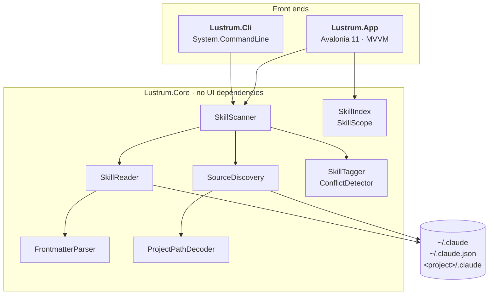
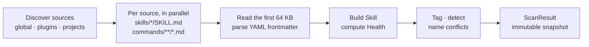

<div align="center">

# Lustrum

**A census of every Claude Code skill on your machine.**

Global skills, per-project skills, plugin skills and slash commands, in one window.<br/>
Read-only. Nothing is written to `~/.claude`.


</div>

## Why

Claude Code spreads skills over several places. `/plugin` shows plugins, `/skills` shows the current project,
and `npx skills list` shows the current folder plus home. Nothing answers the questions that come up once you
have a few dozen skills:

- What skills do I have, and where does each one live?
- Which ones are available in project X?
- Where do names collide?
- Which ones are broken (no frontmatter, bad YAML, missing description)?

Lustrum scans the disk once, builds an immutable snapshot and shows it in a desktop window or prints it from a CLI.

## Quick start

You need the [.NET 10 SDK](https://dotnet.microsoft.com/download).

```bash
git clone https://github.com/sburdenko/lustrum.git
cd lustrum

dotnet run --project src/Lustrum.App                   # the window
dotnet run --project src/Lustrum.Cli -- list           # the same data in the terminal
dotnet test                                            # 74 tests
```

Developed and tested on macOS. The Windows and Linux code paths (`explorer.exe`, `xdg-open`, drive-letter
project folders) exist but have not been run.

## What you get

| | |
|---|---|
| **Source tree** | All, Global, Projects (one node per project), Plugins (marketplace, then plugin), Problems. Every node has a count. |
| **Skill list** | One row per skill or command: name with plugin prefix, description, source, health marker. Sort by name, source or modified date. |
| **Search** | Case-insensitive; every word must match the name, full name, description or a tag. Applies to the current source. |
| **Skill card** | Description, health, parsed frontmatter, file path with size and modification time, sibling files, rendered `SKILL.md`. |
| **Name conflicts** | If a name exists in more than one non-plugin source, the card lists the other locations. |
| **Actions** | Show in file manager, copy path, copy invocation name (`/deploy`, `unity:ui`). |
| **Themes** | Light and dark, following the OS. |
| **Keys** | `Ctrl/Cmd+F` search, `F5` rescan, `Esc` clear search. |

<table>
<tr>
<td width="50%"></td>
<td width="50%"></td>
</tr>
<tr>
<td align="center"><sub>Rendered <code>SKILL.md</code>, dark theme</sub></td>
<td align="center"><sub>Problems group</sub></td>
</tr>
</table>

The screenshots use a synthetic `~/.claude` tree, not a real machine.

## Where it looks

| Source | Location | Skill name |
|---|---|---|
| Global skills | `~/.claude/skills/<folder>/SKILL.md` | `name` from frontmatter, else the folder name |
| Global commands | `~/.claude/commands/**/*.md` (up to 3 levels) | file path without `.md`, folders joined with `:` (`git/squash.md` is `/git:squash`) |
| Project skills and commands | `<project>/.claude/skills`, `<project>/.claude/commands` | same rules as global |
| Plugins | the `installPath` of every entry in `~/.claude/plugins/installed_plugins.json` | `<plugin>:<name>` |

**Which projects.** Lustrum merges two lists by normalised path: the keys of `projects` in `~/.claude.json`
and the folder names in `~/.claude/projects`. Your home directory is skipped there, because its `.claude`
is already the global source. A project whose folder no longer exists stays in the data with `Exists = false`.
The UI hides it until you tick **empty**.

**Which plugin versions.** The registry file is authoritative. Without it, Lustrum falls back to
`~/.claude/plugins/cache/<marketplace>/<plugin>/<version>` and ignores versions that carry an `.orphaned_at` marker.

**Project folder names.** `~/.claude/projects` stores each path with every non-alphanumeric character replaced
by `-`. That mapping is lossy (`my-app`, `my_app` and `my/app` encode the same), so `ProjectPathDecoder`
resolves a name against the real file system: at each level it only follows directories whose own encoded
name is a prefix of the remaining string. Exact paths from `~/.claude.json` win over decoding.
Names that cannot be resolved are shown as missing, not guessed.

More on-disk details are in [docs/claude-code-layout.md](docs/claude-code-layout.md).

## Architecture

Three projects, one rule: **front ends never touch the file system for scanning; everything goes through Core.**



### Scan pipeline



- Sources are scanned with `Parallel.ForEachAsync`, one source per task.
- Only the head of each file is read during a scan. `Skill.Body` stays `null`; the card loads it on demand
  through `SkillBodyReader` (capped at 1 MB).
- A failure to read one file becomes a `ScanIssue` and a `ParseError` skill. It never aborts the scan.

### Data model

Everything in `Lustrum.Core.Models` is an immutable `record`.

```csharp
SkillSource(Id, Kind, DisplayName, RootPath, LastSeen, Exists)
Skill(Id, Name, FullName, Description, Kind, Source, Path, Body, Frontmatter,
      AllowedTools, Files, SizeBytes, Modified, Health, Tags)
Conflict(Name, Skills)
ScanResult(Sources, Skills, Conflicts, Issues, ScannedAt, Duration)
```

- `SourceKind`: `Global`, `Project`, `Plugin`. `SkillKind`: `Skill`, `Command`.
- `Skill.Id` is `<source id>#<path relative to the source root>`. It is unique inside a scan and survives
  a frontmatter rename.
- `FullName` carries the plugin prefix (`unity:ui`). Plugin skills are always prefixed, so they never
  produce a conflict.
- `Skill.Tags` are computed: an own-prefix tag (default `sb-`), `plugin`, `command`, `broken`, `duplicate`.

### Health

| Health | When | Counts as a problem |
|---|---|---|
| `Ok` | name and description present and valid | no |
| `DescriptionTooLong` | description longer than 1024 characters | yes, as a warning |
| `MissingDescription` | frontmatter has no `description` | yes |
| `MissingName` | frontmatter has no `name` (the folder name is used) | yes |
| `NoFrontmatter` | file does not start with `---` (folder name and first body line are used) | yes |
| `ParseError` | unclosed fence, invalid YAML or unreadable file | yes |

Commands are checked more leniently, because Claude Code does not require frontmatter for them: only
`ParseError` and `DescriptionTooLong` apply, and the name is always the file path.

The frontmatter parser strips a BOM, accepts CRLF, converts leading tabs to spaces, and takes
`allowed-tools` as either a YAML list or a comma-separated string (commas inside parentheses are kept,
so `Bash(git:*, status)` stays one entry).

### Search and scopes

`SkillScope` is a small polymorphic hierarchy rather than a set of flags. Each scope decides for itself
which skills it includes.

| Scope | Includes |
|---|---|
| `AllScope` | everything |
| `KindScope(kind)` | all skills from global, project or plugin sources |
| `SourceScope(id)` | one project or one plugin |
| `MarketplaceScope(name)` | every plugin from one marketplace |
| `ProblemsScope` | anything with a health problem, including `DescriptionTooLong` |

`SkillIndex.Search(skills, new SkillQuery(scope, text))` applies the scope first, then the text.

### Threading

- The scan runs on the thread pool; `MainViewModel` applies the result on the UI thread.
- Starting a new rescan cancels the previous one, and a result from a superseded scan is dropped.
- Failures from the scan or from launching the file manager are reported in the status bar.

### The window

`MainViewModel` owns the state (`SearchText`, `SelectedNode`, `SelectedSkill`, `SelectedSort`,
`ShowEmptySources`) and rebuilds `VisibleSkills` when any of them change.

| Piece | Role |
|---|---|
| `NavTreeBuilder` | `ScanResult` to the source tree, with counts and dimmed empty projects |
| `SkillItemViewModel` | one list row |
| `SkillCardViewModel` | the card; loads the `SKILL.md` body in the background |
| `IShellService`, `IClipboardService` | the only places that touch the OS; faked in tests |

## CLI

```text
lustrum list [--json] [--source global|project|plugin] [--broken]
```

```text
$ lustrum list --source plugin
NAME                            SOURCE                       HEALTH              DESCRIPTION
data-kit:chart-builder          data-kit (acme-tools)        ok                  Turn a table into an accessible chart with sensible defaults.
data-kit:csv-clean              data-kit (acme-tools)        ok                  Normalise encodings, delimiters and column names in messy CSV files.
/data-kit:export                data-kit (acme-tools)        ok                  Export the current dataset to CSV or Parquet.
ops-runbooks:incident-response  ops-runbooks (field-guides)  ok                  Walk through an incident: triage, comms, mitigation, follow-up.
review-kit:perf-audit           review-kit (acme-tools)      ok                  Find hot paths and allocation-heavy code in a profile or diff.
review-kit:security-scan        review-kit (acme-tools)      ok                  Scan changed files for injection, secrets and unsafe deserialization.

$ lustrum list --broken
NAME           SOURCE  HEALTH              DESCRIPTION
brand-voice    Global  DescriptionTooLong  Rewrite copy in the house tone of voice. Applies the style guide, banne…
broken-yaml    Global  ParseError          (no description)
legacy-import  Global  NoFrontmatter       Imports old markdown notes.
```

`--json` prints the full `Skill` records, including `frontmatter`, `allowedTools`, `files`, `health` and `tags`.
Files that could not be read are reported on stderr as `warning: <path>: <reason>`.
An unknown `--source` exits with code 2.

## Repository layout

```text
lustrum/
├── src/
│   ├── Lustrum.Core/      Models/  Parsing/  Scanning/  Indexing/
│   ├── Lustrum.App/       Views/  ViewModels/  Services/  Assets/
│   └── Lustrum.Cli/       list command, table renderer
├── tests/
│   ├── Lustrum.Core.Tests/   scanner, parser, decoder, index
│   └── Lustrum.App.Tests/    view models, source tree
├── docs/                  screenshots, Claude Code on-disk notes
├── Directory.Build.props  net10.0, nullable, warnings as errors
└── lustrum.sln
```

## Tests

74 xUnit tests with FluentAssertions. Core tests do not scan your real `~/.claude`: `FakeClaudeHome` builds a
throw-away home directory with skills, commands, plugin registry, project folders and `~/.claude.json`, and the
scanner runs against it. That makes the awkward cases cheap to cover: colliding project keys, malformed registry
files, folders with dashes and dots in their names, frontmatter with a BOM and tabs, oversized frontmatter.
The App tests drive `MainViewModel` with a fake scan function, shell and clipboard, including overlapping
rescans and a failing file manager.

```bash
dotnet test
```

## Built with

[Avalonia 11](https://avaloniaui.net/) · [CommunityToolkit.Mvvm](https://github.com/CommunityToolkit/dotnet) ·
[YamlDotNet](https://github.com/aaubry/YamlDotNet) · [FluentIcons.Avalonia](https://github.com/davidxuang/FluentIcons) ·
[Markdown.Avalonia](https://github.com/whistyun/Markdown.Avalonia) · [System.CommandLine](https://github.com/dotnet/command-line-api) ·
xUnit

## Limitations

- Only files on disk are visible. Skills managed in claude.ai settings and skills bundled with Claude are not listed.
- Lustrum lists what exists. It does not compute which of two same-named skills Claude Code will pick in a project.
- Every start runs a full scan; there is no cache and no file watching. Press `F5` to rescan.
- The own-prefix tag (`sb-`) is a default in `ScanOptions` and is not editable in the UI.
- Search is a plain substring match, not fuzzy.

## Name

A *lustrum* was the Roman census, taken every five years: count everyone, then purify the books.
